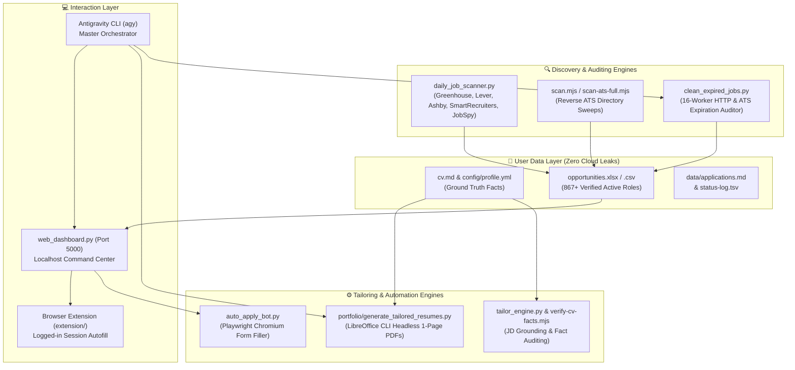

# AutoJobHunt & Career-Ops: Windows Takeover & Migration Handover

> **Document Type:** Master Handover & Operational Blueprint  
> **Target OS:** Windows 11 / Windows 10 (Migrating from Fedora Linux)  
> **Target AI Agent:** Antigravity CLI / IDE (`agy`) & Collaborative Pair Programming Agents  
> **Candidate Profile:** Rishi Thakur ([config/profile.yml](file:///home/rishi21/Desktop/Jobhunt/Bot/config/profile.yml) · [cv.md](file:///home/rishi21/Desktop/Jobhunt/Bot/cv.md))  
> **Repository Repositories:**
> - Bot Core: `https://github.com/rishi-th219/autojobhunt.git`
> - Portfolio & Tailoring: `https://github.com/rishi-th219/portfolio.git`

---

## 1. Executive Summary & Architecture

**AutoJobHunt** is a 100% local-first, autonomous job discovery, link auditing, resume tailoring, and browser-assisted application pipeline built on the open-source **career-ops** architecture by santifer.

### System Architecture Diagram



### Dual-Repository Layout
The system relies on two sibling repositories located within a single root folder (e.g., `C:\Users\<user>\Desktop\Jobhunt` or `D:\Jobhunt`):
```text
Jobhunt/
├── Bot/                                 # https://github.com/rishi-th219/autojobhunt.git
│   ├── .agents/skills/career-ops/       # Canonical open agent skill (SKILL.md)
│   ├── config/profile.yml               # Ground truth candidate data
│   ├── cv.md                            # Primary factual CV
│   ├── data/                            # applications.md, pipeline.md, status-log.tsv
│   ├── extension/                       # Unpacked Chrome/Brave extension for logged-in autofill
│   ├── opportunities.xlsx / .csv        # 867+ verified active opportunities across 408 companies
│   ├── web_dashboard.py                 # Localhost browser command center (Port 5000)
│   ├── autofill_assistant.py            # Local autofill API server (Port 5001)
│   ├── daily_job_scanner.py             # Multi-channel discovery scanner
│   ├── clean_expired_jobs.py            # High-speed link liveness auditor
│   ├── auto_apply_bot.py                # Standalone Playwright auto-apply bot
│   ├── AGENTS.md                        # Primary Antigravity system instructions & contract
│   └── package.json / requirements.txt  # Project dependencies
└── portfolio/                           # https://github.com/rishi-th219/portfolio.git
    ├── generate_tailored_resumes.py     # Cross-platform LibreOffice DOCX/PDF resume builder
    ├── tailoring/                       # Role-specific tailored DOCX/MD/PDF resumes
    ├── assets/                          # Deployed portfolio PDFs & default resume
    └── index.html                       # Public portfolio website
```

---

## 2. Windows System Prerequisites

Before bootstrapping the environment, install the following software on Windows:

1. **Git for Windows:**
   - Download: [git-scm.com](https://git-scm.com/)
   - Important: When installing, select **"Enable symbolic links"** and **"Checkout as-is, commit Unix-style line endings"** (`core.autocrlf = input` or `false`).
2. **Python 3.11 or 3.12 (64-bit):**
   - Download: [python.org](https://www.python.org/)
   - **CRITICAL:** Check the box **"Add Python to PATH"** during installation.
3. **Node.js 22 LTS or 20 LTS:**
   - Download: [nodejs.org](https://nodejs.org/)
   - Includes `npm` and `npx`.
4. **LibreOffice 24+ (for 1-page PDF Compilation):**
   - Download: [libreoffice.org](https://www.libreoffice.org/)
   - Default install path: `C:\Program Files\LibreOffice\program\soffice.exe`.
   - *Recommendation:* Add `C:\Program Files\LibreOffice\program` to your Windows System `PATH` so `soffice` is globally recognized.
5. **Modern Chromium Browser:**
   - Brave, Google Chrome, or Microsoft Edge (used to run the local unpacked extension and logged-in job portals).
6. **Windows Terminal (PowerShell 7 recommended):**
   - Available via Microsoft Store or `winget install Microsoft.PowerShell`.

---

## 3. Step-by-Step Windows Installation & Bootstrapping

Open **PowerShell as Administrator** (or regular PowerShell if execution policy is already configured) and run the following commands:

### Step 3.1: Enable PowerShell Script Execution
```powershell
Set-ExecutionPolicy -ExecutionPolicy RemoteSigned -Scope CurrentUser
```

### Step 3.2: Enable Git Long Paths & Clone Both Repositories
```powershell
# Prevent Windows MAX_PATH (260 character) limits
git config --system core.longpaths true

# Navigate to your workspace directory (e.g. Desktop\Jobhunt)
mkdir "$HOME\Desktop\Jobhunt"
cd "$HOME\Desktop\Jobhunt"

# Clone Bot (AutoJobHunt) with symlinks enabled
git clone -c core.symlinks=true https://github.com/rishi-th219/autojobhunt.git Bot

# Clone Portfolio & Tailoring
git clone -c core.symlinks=true https://github.com/rishi-th219/portfolio.git portfolio
```

### Step 3.3: Set Up Python Virtual Environment
```powershell
cd "$HOME\Desktop\Jobhunt\Bot"

# Create virtual environment
python -m venv .venv

# Activate virtual environment
.\.venv\Scripts\Activate.ps1

# Upgrade pip and install wheel
python -m pip install --upgrade pip setuptools wheel

# Install core python requirements
pip install -r requirements.txt

# Ensure additional scraper & browser automation packages are installed
pip install python-jobspy openpyxl pyyaml playwright beautifulsoup4 requests

# Install Playwright browser binaries (Chromium)
playwright install chromium
```

### Step 3.4: Install Node.js Dependencies
```powershell
# From $HOME\Desktop\Jobhunt\Bot
npm install
```

### Step 3.5: Verify LibreOffice CLI
Verify that LibreOffice is reachable for headless resume generation:
```powershell
& "C:\Program Files\LibreOffice\program\soffice.exe" --version
# Expected output: LibreOffice 24.x.x.x ...
```

### Step 3.6: Test Resume Compilation
Run the cross-platform resume generator to test DOCX creation and PDF conversion:
```powershell
python "..\portfolio\generate_tailored_resumes.py"
```
*Expected Output:*
```text
Generated DOCX: ...\portfolio\tailoring\Rishi_Thakur_SQL_Developer_Resume.docx
Converted PDF: ...\portfolio\tailoring\Rishi_Thakur_SQL_Developer_Resume.pdf
...
Converted PDF: ...\portfolio\tailoring\Rishi_Thakur_Supply_Chain_Analyst_Resume.pdf
Updated default Rishi_Thakur_Resume.pdf from SQL Developer
```

### Step 3.7: Load Unpacked Browser Extension (For Logged-In Sessions)
1. Open **Brave** (`brave://extensions`) or **Google Chrome** (`chrome://extensions`).
2. In the top-right corner, toggle **Developer mode** to **ON**.
3. Click **Load unpacked** (top-left).
4. Browse to and select: `C:\Users\<user>\Desktop\Jobhunt\Bot\extension`.
5. Pin the AutoJobHunt extension icon to your browser toolbar.

---

## 4. Antigravity (`agy`) Setup & Skills Configuration

### 4.1 Installing Antigravity on Windows
Install the Antigravity CLI globally or ensure your AGY environment is authenticated:
```powershell
# If installing via npm:
npm install -g @google/antigravity

# Or authenticate your session:
agy auth login
# Alternatively, set your environment variable:
$env:GEMINI_API_KEY = "your-api-key-here"
```

### 4.2 How Antigravity Takes Over the Project
When you open `Jobhunt\Bot` in Antigravity (or start `agy` from the terminal):
1. **Instruction Ingestion (`AGENTS.md`):** Antigravity automatically detects and reads `AGENTS.md` in the repository root. `AGENTS.md` defines the entire Data Contract, Source-of-Truth Boundary, verification rules, and mode guidelines.
2. **Skill Discovery:** Antigravity looks for skills in `.agents/skills/career-ops/SKILL.md`.
   > **Windows Symlink Note:** If Git checked out `.antigravitycli/skills/career-ops/SKILL.md` as a plain text pointer, Antigravity still finds `.agents/skills/career-ops/SKILL.md` directly. If ever needed, run:
   > ```powershell
   > New-Item -ItemType HardLink -Path .antigravitycli\skills\career-ops\SKILL.md -Target .agents\skills\career-ops\SKILL.md -Force
   > ```
3. **Operational Persona:** The agent immediately recognizes the candidate (Rishi Thakur), the 867+ verified opportunities database, the tailoring tracks, and the zero-fabrication rules.

---

## 5. Candidate Profile & Source of Truth Boundary

### Single Source of Truth
All user-facing content (CVs, cover letters, application forms, recruiter messages) must **strictly and exclusively** originate from:
- `cv.md` (Primary factual CV)
- `config/profile.yml` (Structured candidate configuration)
- `modes/_profile.md` (Targeting, archetypes, comp expectations)

### The Cardinal Rule: Zero Fabrication
- **"Keywords get reformulated, never fabricated."**
- Never invent metrics, scales, tools, or responsibilities.
- Never claim authorship of an open-source project or system unless explicitly stated in `cv.md`.
- All numbers, percentages, and dollar amounts must trace directly to `cv.md`.

### Candidate Summary
- **Name:** Rishi Thakur
- **Email:** `rishi_th219@proton.me`
- **Phone:** `+91 8109830219`
- **Location:** Bengaluru, Karnataka, India
- **Education:** M.Tech in Computer Science & Engineering (Specialization: Data Science & AI — DSAI), IIIT Naya Raipur (CGPA 7.90, 2024–2026)
- **Previous Degree:** B.Tech in CSE, Amity University Chhattisgarh (CGPA 7.71, 2019–2023)
- **Primary Experience:** Data Analyst & Analytics Intern at Chhattisgarh Infotech Promotion Society (CHiPS) / Dept. of Health & Family Welfare (~1 Year)
- **Notice Period:** Immediate / 15 Days
- **Work Authorization:** Authorized to work in India; does NOT require visa sponsorship.

### 5 Dedicated Resume Tracks & Dynamic Resolution
`config_loader.py` dynamically selects the exact matching resume PDF for any job posting:

| Track | Regex Pattern Match | Resume PDF Path (`portfolio/tailoring/` & `assets/`) |
| :--- | :--- | :--- |
| **Supply Chain Analyst** | `supply chain`, `inventory`, `materials plan`, `logistics`, `procurement`, `demand plan`, `pfep` | `Rishi_Thakur_Supply_Chain_Analyst_Resume.pdf` |
| **SQL Developer** | `sql`, `database`, `dba`, `data engineer`, `etl`, `warehouse`, `postgres`, `oracle` | `Rishi_Thakur_SQL_Developer_Resume.pdf` |
| **Data Analyst** | `data analyst`, `data analytics`, `analytics`, `analyst` | `Rishi_Thakur_Data_Analyst_Resume.pdf` |
| **Business Analyst** | `business analyst`, `strategy`, `operations analyst`, `consultant`, `process analyst` | `Rishi_Thakur_Business_Analyst_Resume.pdf` |
| **Power BI Developer** | `power bi`, `tableau`, `looker`, `oac`, `bi developer`, `dashboard`, `reporting` | `Rishi_Thakur_PowerBI_Developer_Resume.pdf` |
| **AI / ML & Research** | `machine learning`, `ml`, `artificial intelligence`, `data scientist`, `deep learning` | `Rishi_Thakur_Data_Science_Resume.pdf` / `ML_Engineer_Resume.pdf` |
| **Python Backend** | `python`, `fastapi`, `flask`, `django`, `backend engineer`, `sde` | `Rishi_Thakur_Python_Developer_Resume.pdf` |

---

## 6. Daily Operational Playbook for Antigravity & User

### Routine 1: Starting the Localhost Web Dashboard
The command center runs on Python standard library with zero external web framework bloat:
```powershell
cd "$HOME\Desktop\Jobhunt\Bot"
.\.venv\Scripts\Activate.ps1
python web_dashboard.py
```
- **Access UI:** Open `http://localhost:5000` in Brave/Chrome.
- **Features:** Instant client-side search across all 867+ roles, city pills (Bengaluru, Pune, Mumbai, Gurgaon, Remote), track filters, 1-click in-browser discovery scans, and 1-click auto-apply.

### Routine 2: Using the Browser Extension in Logged-In Sessions
When applying on platforms requiring your personal login (LinkedIn Easy Apply, Workday, Naukri, Greenhouse):
1. Keep `web_dashboard.py` running in the background.
2. In your normal browser tab, open the job application page.
3. Click the **AutoJobHunt** extension icon and click **"⚡ Autofill Current Form"**.
4. The extension instantly detects all text inputs, email, phone, LinkedIn, years of experience, and dropdowns, setting their values natively and triggering framework change events.
5. Review the pre-filled fields and click **Submit**.

### Routine 3: Running Daily Job Discovery
To pull new jobs into `data/pipeline.md` and sync with `opportunities.xlsx`:
```powershell
# Run the multi-channel Python scanner (Greenhouse, Lever, Ashby, SmartRecruiters, JobSpy)
python daily_job_scanner.py

# Or run Node ATS sweeps
node scan.mjs
```

### Routine 4: Link Liveness & Expired Jobs Cleanup
Verify all URLs across the spreadsheet and archive dead postings:
```powershell
python clean_expired_jobs.py
```
- Uses a 16-worker concurrent connection pool.
- Validates HTTP response codes and ATS expiration phrases ("Job closed", "No longer accepting applications").
- Automatically moves dead links to `data/archived_expired_opportunities.csv` and rewrites clean spreadsheets.

### Routine 5: Tailoring a Resume for a Specific Job Description
When the user pastes a new JD or asks `agy` to tailor a resume:
1. Identify the matching track from Section 5.
2. If tailoring a custom variant, generate Markdown in `portfolio/tailoring/Rishi_Thakur_<Role>_Resume.md`.
3. Verify all facts against `cv.md`:
   ```powershell
   node verify-cv-facts.mjs portfolio\tailoring\Rishi_Thakur_<Role>_Resume.md
   ```
4. If modifying the core configs, edit `portfolio/generate_tailored_resumes.py` and compile:
   ```powershell
   python "..\portfolio\generate_tailored_resumes.py"
   ```
5. Check ATS compliance and structural consistency:
   ```powershell
   node ats-payload.mjs
   node verify-cv-structure.mjs
   ```

### Routine 6: Tracking Application Status
Update the canonical application tracker:
```powershell
# Mark a job as Applied
node set-status.mjs "Cisco" Applied --note "Tailored Supply Chain BA resume submitted"

# View pipeline statistics
node stats.mjs --summary
```

---

## 7. Troubleshooting Windows Quirks & Common Gotchas

| Issue | Root Cause | Immediate Fix |
| :--- | :--- | :--- |
| **`Activate.ps1 cannot be loaded because running scripts is disabled`** | PowerShell ExecutionPolicy default restriction | Run: `Set-ExecutionPolicy -ExecutionPolicy RemoteSigned -Scope CurrentUser` in PowerShell. |
| **`LibreOffice / soffice is not recognized`** | LibreOffice not in System PATH | Add `C:\Program Files\LibreOffice\program` to Windows Environment PATH, or rely on `generate_tailored_resumes.py` which auto-detects standard Windows install locations. |
| **`Filename too long` during `git clone`** | Windows 260-character path limit | Run `git config --system core.longpaths true` as Administrator before cloning. |
| **`playwright._impl._errors.Error: Executable doesn't exist`** | Playwright Chromium binaries not downloaded | Run: `playwright install chromium` inside your activated `.venv`. |
| **`Port 5000 already in use`** | Lingering background Python process | In PowerShell, find and kill the process: `Get-Process python \| Stop-Process` or test with `netstat -ano \| findstr :5000`. |
| **`Symlinks appearing as small text files`** | Windows Developer Mode disabled or `core.symlinks` false during clone | Enable Developer Mode in Windows Settings (`Settings > System > For developers > Developer Mode`) and clone with `git clone -c core.symlinks=true`. |
| **`UnicodeEncodeError` in Windows Terminal** | Default Windows console code page (cp1252) | Set environment variable `$env:PYTHONIOENCODING = "utf-8"` or run `chcp 65001` in CMD/PowerShell. |

---

## 8. Summary Checklist for agy on Day 1 (Windows)

When taking over this project on Windows, verify these 5 checkpoints:

- [ ] **Checkpoint 1: Repositories Cloned:** `Jobhunt\Bot` and `Jobhunt\portfolio` exist side-by-side.
- [ ] **Checkpoint 2: Virtual Environment Active:** `.\.venv\Scripts\Activate.ps1` runs cleanly with `python-jobspy`, `playwright`, `pyyaml`, `openpyxl`.
- [ ] **Checkpoint 3: LibreOffice Functional:** `python ..\portfolio\generate_tailored_resumes.py` successfully produces 5 track PDFs.
- [ ] **Checkpoint 4: Web Dashboard Live:** `python web_dashboard.py` serves 867+ verified opportunities at `http://localhost:5000`.
- [ ] **Checkpoint 5: Browser Extension Loaded:** Unpacked extension loaded in Brave/Chrome with autofill active.

*Handover document authored and certified for seamless Fedora-to-Windows transition.*
